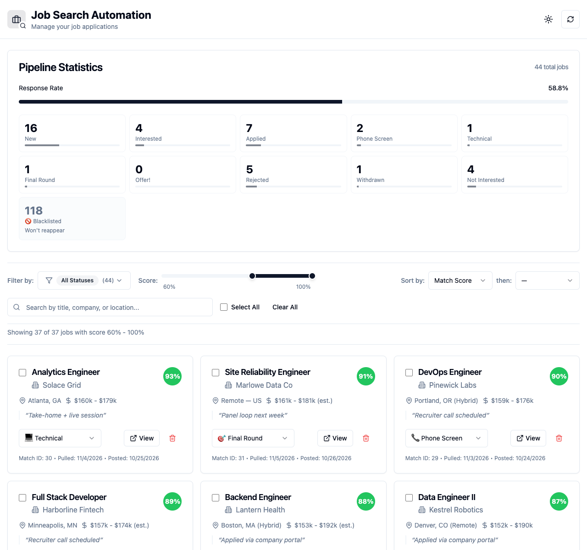

# Job Search Automation System

An AI-powered job search, matching, and tracking system that automates the discovery, scoring, and management of job opportunities.

## 🎯 What It Does

This system automates your entire job search workflow:

1. **🔍 Job Discovery** - Fetches jobs from the Adzuna API based on customizable search profiles
2. **🤖 Intelligent Matching** - Uses hybrid (keyword + OpenAI semantic) scoring to rank jobs by relevance
3. **📝 Resume Parsing** - Extracts skills and experience from your PDF resume
4. **🚫 Smart Filtering** - Automatically excludes blacklist entries and minimum score thresholds
5. **📊 Web Dashboard** - React-based UI for managing, filtering, and updating job statuses
6. **🔄 Notion Sync** - Two-way sync with Notion Kanban board for status management
7. **🗑️ Permanent Blacklist** - Deleted jobs automatically blacklisted to prevent re-adding

## 📸 Dashboard



*Seeded demo data — 44 fictional jobs at made-up companies.*

## 🚀 Quick Start

### Prerequisites

- Python 3.10+
- Node.js 18+
- Adzuna API credentials (free tier available)
- OpenAI API key (for semantic matching)
- (Optional) Notion integration token

### 1. Setup Environment

```bash
# Clone/setup directory
cd ~/job-search-automation

# Create Python virtual environment
python -m venv venv
source venv/bin/activate  # On Windows: venv\Scripts\activate

# Install Python dependencies
pip install -r requirements.txt
```

### 2. Configure 1Password Secret References

Install the [1Password CLI](https://developer.1password.com/docs/cli/) and authenticate it.
Copy `credentials.example.json` to `credentials.json` in the project root and
replace the example references with your actual `op://vault/item/field` paths.
Use **Copy Secret Reference**, not a 1Password share URL. Remove entries for
optional integrations you do not use. `NOTION_DATABASE_ID` may be a plain ID.

The CLI and API integrations resolve references with `op read` when needed.
Resolved values stay in process memory; the loader does not export them as
API-key environment variables or write them to disk. Configuration is found
relative to the project, independently of the launch directory.

Precedence: explicit constructor argument, then `credentials.json`, then legacy
environment variable. Constructor arguments and legacy environment variables
can also contain `op://` references. A configured reference that cannot be read
raises an error instead of falling back to a different key. Legacy environment
support remains for existing installations; `.env` is not automatically loaded.

For unattended scheduling, use noninteractive 1Password authentication such as
a vault-scoped service account. Desktop-app authentication may require approval
and is not a reliable headless setup. A service account still needs its own
bootstrap credential; this change removes application keys from environment
variables, not 1Password's authentication requirement.

Do not remove existing credentials until the corresponding integrations have
been verified with your actual references.

**Getting API Keys:**
- **Adzuna**: Sign up at [developer.adzuna.com](https://developer.adzuna.com)
- **OpenAI**: Get key at [platform.openai.com](https://platform.openai.com)
- **Notion**: Create integration at [notion.so/my-integrations](https://notion.so/my-integrations)

### 3. Initialize Database

```bash
source venv/bin/activate
python -c "from src.database import init_database; init_database()"
```

This creates `data/job_search.db` with tables for jobs, matches, and blacklist.

### 4. Configure Your Resume

Edit `resume_config.json`:

```json
{
  "name": "Your Name",
  "title": "Clinical Informatics Analyst",
  "years_experience": 10,
  "location": "Remote",
  "required_skills": [
    "Python",
    "SQL",
    "HL7",
    "FHIR"
  ],
  "preferred_titles": [
    "Clinical Informatics Analyst",
    "Health Data Analyst",
    "EHR Systems Analyst"
  ],
  "excluded_keywords": [
    "Junior",
    "Entry level",
    "Travel assignment"
  ],
  "target_salary_min": 85000,
  "target_salary_max": 125000,
  "min_match_score": 10,
  "min_semantic_score": 15
}
```

**Key Settings:**
- `min_match_score` (0-100): Minimum keyword match score to save job
- `min_semantic_score` (0-100): Minimum OpenAI semantic score to save job
- `excluded_keywords`: Terms that disqualify jobs from being saved

### 5. Parse Your Resume PDF (Optional but Recommended)

```bash
python src/cli.py --parse-resume ~/path/to/your_resume.pdf
```

This extracts skills and populates the config automatically.

### 6. Start the Web UI

```bash
# Terminal 1: API Server
source venv/bin/activate
python api_server.py

# Terminal 2: React Dev Server
cd web
npm install
npm run dev
```

Open http://localhost:5173 in your browser.

## 📖 Usage Guide

### CLI Commands

```bash
# Search for jobs with semantic matching
python src/cli.py --search-profile technical --match --semantic

# View all tracked matches
python src/cli.py --display

# Update a job's status
python src/cli.py --update-status 123 --to-status applied

# Sync to Notion
python src/cli.py --sync-notion

# Pull status changes FROM Notion
python src/cli.py --pull

# View with limit
python src/cli.py --display --limit 20

# Filter by status
python src/cli.py --display --status interested

# Search for specific terms in saved jobs
python src/cli.py --search "machine learning" --match --display
```

### Search Profiles

Pre-configured search profiles in `cli.py`:

| Profile | Description |
|---------|-------------|
| `leadership` | Director, VP, CTO roles |
| `technical` | Senior/Staff engineer roles |
| `hands_on` | Python/TypeScript/Rust focused |
| `ai` | AI/ML engineering roles |
| `consulting` | Consulting/architecture roles |

### Web UI Features

| Feature | Description |
|---------|-------------|
| 🔍 Search Filter | Filter by title, company, location (client-side) |
| 🎚️ Min Score Slider | Show only jobs above X% match (API filter) |
| 🏷️ Status Filter | Filter by pipeline status |
| ✅ Bulk Select | Select multiple jobs for batch actions |
| 🚫 Bulk Blacklist | Permanently remove multiple jobs |
| 📊 Status Dropdown | Update pipeline status inline |
| 📈 Stats Panel | Pipeline metrics and counts |
| 🗑️ Delete | Move individual jobs to blacklist |
| 🔄 Refresh | Reload data from API |

### Status Workflow

```
new → interested → applied → phone_screen → technical_interview → final_interview → offer
        ↓              ↓
     rejected      withdrawn
```

### Notion Integration

**Setup:**
1. Create Notion integration at notion.so/my-integrations
2. Store the token in 1Password and set `NOTION_TOKEN` in `credentials.json` to its secret reference
3. Create a database with properties: Title, Company, Location, Match Score, Status, URL
4. Share database with your integration
5. Copy database ID to `.env` as `NOTION_DATABASE_ID`

**Sync Behavior:**
- `--sync-notion`: Pushes new jobs from SQLite → Notion
- `--pull`: Pulls status changes from Notion → SQLite
- Duplicates are prevented by tracking Notion page IDs

## ⚙️ Configuration Files

### `resume_config.json`

| Field | Type | Description |
|-------|------|-------------|
| `name` | string | Your full name |
| `title` | string | Current/target job title |
| `years_experience` | int | Years of experience |
| `location` | string | Preferred location (Remote, City, etc.) |
| `required_skills` | list | Must-have technical skills |
| `preferred_titles` | list | Desired job titles |
| `excluded_keywords` | list | Terms that disqualify jobs |
| `target_salary_min` | int | Minimum acceptable salary |
| `target_salary_max` | int | Maximum desired salary |
| `min_match_score` | int | Minimum keyword score (0-100) |
| `min_semantic_score` | int | Minimum semantic score (0-100) |

### `data/job_search.db`

SQLite database with tables:
- `jobs`: Job postings from sources
- `matches`: Scored job-resume combinations
- `resumes`: Parsed resume data
- `applications`: Application tracking
- `blacklist`: Permanently excluded job IDs

## 🔧 Advanced Features

### Blacklist System

When you delete a job via CLI or Web UI:
1. Job status is set to `blacklisted` in SQLite (preserved for Notion sync)
2. Adzuna ID is added to `blacklist` table
3. Future searches skip blacklisted IDs
4. Prevents re-adding rejected jobs
5. Blacklisted jobs are hidden from the Web UI by default

### Hybrid Matching Algorithm

```
Keyword Score (40% weight):
  - Matches against required_skills
  - Partial matches counted
  
Semantic Score (60% weight):
  - OpenAI embedding comparison
  - Job description vs resume semantic similarity
  
Final Score = (keyword * 0.4) + (semantic * 0.6)
```

### Filtering Pipeline

```
Adzuna Results
    ↓
Excluded Keywords Check (title/description)
    ↓
Keyword Scoring (required_skills matching)
    ↓
Semantic Scoring (OpenAI embeddings)
    ↓
Minimum Score Check (config thresholds)
    ↓
Blacklist Check (previously deleted)
    ↓
Save to SQLite ← Only good matches make it!
```

## 🛠️ Troubleshooting

### API Server Not Responding

```bash
# Check if running
curl http://localhost:8000/api/stats

# Restart
pkill -f api_server.py
python api_server.py
```

### No Jobs Found

1. Check Adzuna credentials in `.env`
2. Verify `resume_config.json` has reasonable settings
3. Try different search profile: `--search-profile all`
4. Check Adzuna API rate limits

### Notion Sync Issues

1. Verify `NOTION_TOKEN` is valid
2. Ensure database is shared with integration
3. Check `NOTION_DATABASE_ID` format (32 chars, no dashes)
4. Try `--dry-run` flag to preview changes

### Build Errors

```bash
cd web
rm -rf node_modules package-lock.json
npm install
npm run build
```

## 📁 Project Structure

```
job-search-automation/
├── api_server.py          # FastAPI backend
├── resume_config.json     # Your resume/profile settings
├── requirements.txt       # Python dependencies
├── .env                   # API keys (not committed)
├── src/
│   ├── cli.py             # Command-line interface
│   ├── database.py        # SQLite operations
│   ├── matcher.py         # Scoring algorithms
│   ├── embedding_matcher.py # Semantic matching
│   ├── job_searcher.py    # Job search API
│   ├── notion_sync.py     # Notion integration
│   ├── resume_parser.py   # PDF parsing
│   └── tracking.py        # Application tracking
├── web/
│   ├── src/
│   │   ├── App.tsx        # Main app component
│   │   ├── components/    # React components
│   │   │   ├── JobCard.tsx
│   │   │   ├── JobList.tsx
│   │   │   ├── StatusFilter.tsx
│   │   │   ├── StatsPanel.tsx
│   │   │   └── ...
│   │   ├── hooks/         # useJobs, useStats
│   │   └── types/         # TypeScript definitions
│   └── package.json
└── data/
    └── job_search.db      # SQLite database
```

## 🤝 Contributing

This is a personal job search tool, but feel free to fork!

## 📝 License

MIT License - Use at your own risk for job searching.

---

**Happy job hunting! 🚀**

For issues or questions, check the code in `src/` or run with `--help` flag.